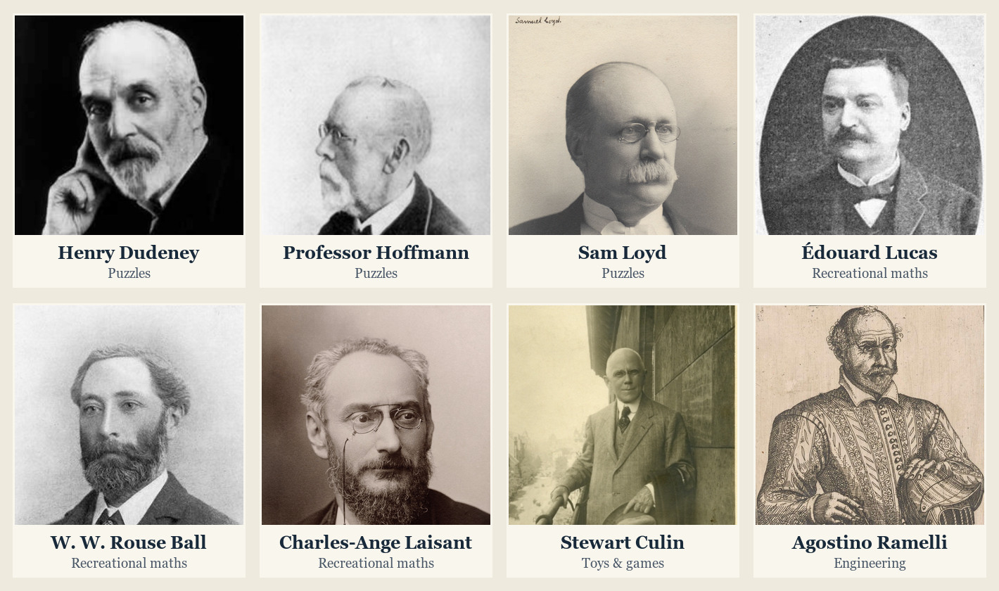
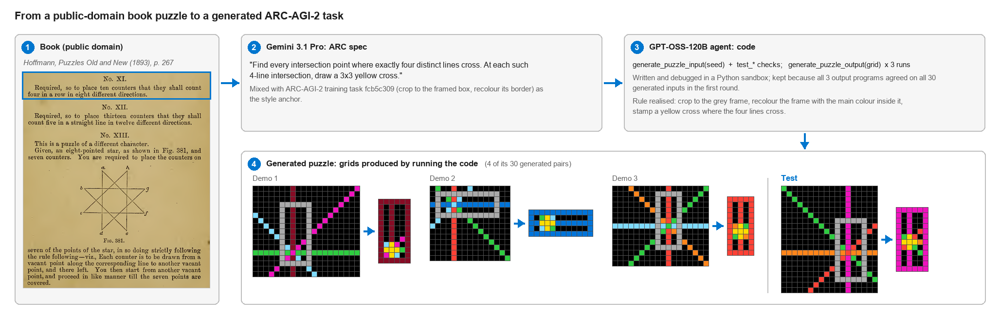

# NVBANANA solution to ARC-AGI-2 2026

This repository is being assembled to document and reproduce the NVBANANA submissions to the [ARC Prize 2026 competition on Kaggle](https://www.kaggle.com/competitions/arc-prize-2026-arc-agi-2).

The [solution writeup](https://www.kaggle.com/competitions/arc-prize-2026-arc-agi-2/writeups/arc-agi-2-public-3rd-place-solution) describes four parts.

- Book-inspired synthetic puzzle generation
- Supervised fine-tuning of Qwen3.8-27B
- Checkpoint conversion for inference on four L4 GPUs
- Per-puzzle test-time fine-tuning and a Flash-Next blend

## Synthetic Data Generation

The pipeline turns book pages into structured puzzle specifications, pairs them with ARC-AGI-2 training-task summaries, and generates and verifies input and output programs. The release example uses four augmented training rows per accepted base puzzle.

*Eight authors whose works inspired the puzzles. [Portrait credits](sdg/assets/portrait-credits.md).*

The two Kaggle notebooks demonstrate this workflow on pages from Hoffmann's *Puzzles Old and New*.

1. [Book to ARC specs with Gemini](https://www.kaggle.com/code/darraghdog/book-to-arc-specs-with-gemini)
2. [Book spec to ARC puzzles with Flash](https://www.kaggle.com/code/darraghdog/book-spec-to-arc-puzzles-with-flash)

*Hoffmann’s counters puzzle became an ARC-AGI-2 task about line crossings. [Puzzles Old and New (1893), p. 267](https://archive.org/details/puzzlesoldnew00hoff).*

## Model Training

The text model is Qwen3.8-27B fine-tuned with NeMo RL and Megatron. The release will include a small training recipe and a record of the production checkpoint lineage.

## Weight Preparation

The 27B notebook uses the mixed GPTQ export of step 188222. The blend also uses Qwen3.8-Flash-Next pruned to 352 experts per layer. The release will document conversion and installation for both checkpoints.

## Kaggle Inference

The baseline uses per-puzzle LoRA test-time fine-tuning followed by SGLang sampling and voting. The blend also runs Flash-Next on the least-confident outputs.

- [Qwen3.8-27B baseline notebook](https://www.kaggle.com/code/darraghdog/fast-v18-insp4-to-16-ep1-6-ttft32-s48-symlink?scriptVersionId=361158513)
- [Qwen3.8-27B and Flash-Next blend notebook](https://www.kaggle.com/code/darraghdog/blend-v18-27b-text-po358-fnt07cs72)

The [inference instructions](inference/README.md) list the notebook snapshots and versioned dependencies.
