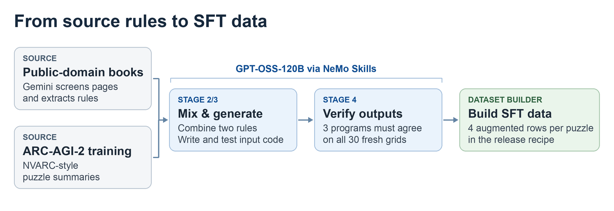

# NVBANANA solution to ARC-AGI-2 2026

This repository is being assembled to document and reproduce the NVBANANA submissions to the [ARC Prize 2026 competition on Kaggle](https://www.kaggle.com/competitions/arc-prize-2026-arc-agi-2).

The [solution writeup](https://www.kaggle.com/competitions/arc-prize-2026-arc-agi-2/writeups/arc-agi-2-public-3rd-place-solution) describes four parts.

- Book-inspired synthetic puzzle generation
- Supervised fine-tuning of Qwen3.8-27B
- Checkpoint conversion for inference on four L4 GPUs
- Per-puzzle test-time fine-tuning and a Flash-Next blend

## Synthetic Data Generation

The [SDG guide](sdg/README.md) shows how book ideas became verified ARC puzzles, with a worked Hoffmann example and two Kaggle demos. The [book sourcing guide](sdg/sourcing/README.md) contains the example bibliography and prompts. The [dataset builder](sdg/dataset/README.md) turns accepted puzzles into four augmented SFT rows each.

*From a counters puzzle in Hoffmann’s Puzzles Old and New (1893) to a generated ARC-AGI-2 task.*

## Model Training

The text model is Qwen3.8-27B fine-tuned with NeMo RL and Megatron. The [training guide](training/README.md) builds the ARC-16 base and runs the reduced SFT recipe. The [production record](training/production.md) traces the dataset mixtures and checkpoints through step 188222.

## Weight Preparation

The [weight preparation guide](weights/README.md) exports step 188222, rebuilds the ARC training calibration prompts, and packages the mixed GPTQ weights and split TTFT configs used on Kaggle. The [Flash-Next weight preparation guide](weights/flash/README.md) rebuilds and packages the 352-expert checkpoint used by the blend.

## Kaggle Inference

The baseline uses per-puzzle LoRA test-time fine-tuning followed by SGLang sampling and voting. The blend also runs Flash-Next on the least-confident outputs.

- [Qwen3.8-27B baseline notebook](https://www.kaggle.com/code/darraghdog/fast-v18-insp4-to-16-ep1-6-ttft32-s48-symlink?scriptVersionId=361158513)
- [Qwen3.8-27B and Flash-Next blend notebook](https://www.kaggle.com/code/darraghdog/blend-v18-27b-text-po358-fnt07cs72)

The [inference instructions](inference/README.md) list the notebook snapshots and versioned dependencies.

## Glossary

| Term | Meaning |
| --- | --- |
| ARC-16 | The 16-token vocabulary (digits 0–9, newline, user, assistant, padding, message start, message end) and the Qwen3.8-27B base cut down to it. |
| SDG | Synthetic data generation. |
| Stage 2/3, Stage 4 | Generation stages, numbered as in NVARC. Stage 1 writes rule summaries of ARC training tasks and book specs. Stage 2/3 mixes two summaries into a new rule and writes and tests its input generator. Stage 4 writes independent output programs and keeps puzzles on which they agree. |
| TIR | Tool-integrated reasoning: the NVARC-style pipeline in which GPT-OSS-120B writes and runs Python while generating puzzles. |
| RD1 | The first production round of that pipeline. IDs such as `rd1_20854` name a generated pair from it. |
| INSP*n* | Numbered book-inspiration SDG rounds (INSP4, INSP11, INSP16, …). A letter suffix such as INSP16A marks a batch within a round. |
| `_075` / `_025` | The two disjoint partitions (about 75% and 25%) of each synthetic dataset, used in different training phases. |
| src11plus16abcd | Name of the final training mixture, used in the released dataset and model slugs. The [production record](training/production.md) lists its contents. |
| TTFT | Test-time fine-tuning: a per-puzzle LoRA trained on that puzzle's demonstration pairs before sampling. |
| WSD | Warmup–stable–decay learning-rate schedule. |
| MXFP8 | 8-bit microscaling floating-point format used for part of training. |
| GPTQ, W4/W8 | Post-training weight quantization and the 4-bit or 8-bit weight widths used for Kaggle. |
| Flash-Next | Qwen3.8-Flash-Next, the mixture-of-experts model used in the blend. |
| REAP448 | The public Flash-Next checkpoint pruned with REAP (Router-weighted Expert Activation Pruning) to 448 of 512 routed experts per layer. |
| po352 | Our further pruned Flash-Next with 352 routed experts per layer. The blend notebook's name says `po358`; its attached weights are po352. |
| Rule A | The blend's rule for which 27B outputs Flash-Next re-solves and when its answer replaces the 27B answer. See [flash_rule_a.py](inference/flash/flash_rule_a.py). |
| fnt07cs72 | Name of the Flash harness configuration used by the blend. |
| r*MMDD* | Date tags such as `r1026` (26 October) kept in some asset and file names. |

## License

This repository is released under [CC BY 4.0](LICENSE). Models, data, code and images from other sources keep their own licenses, listed in the [third-party notices](THIRD_PARTY_NOTICES.md).
