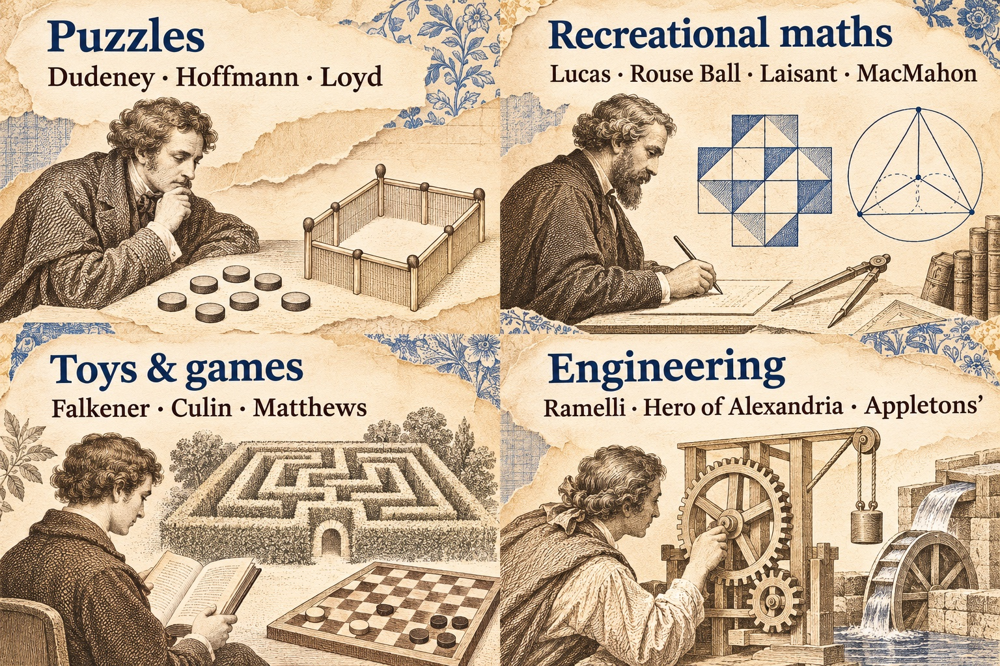
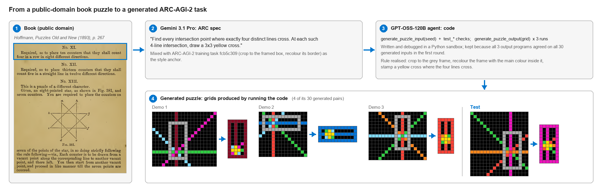

# Synthetic Data Generation

Old puzzle books, recreational mathematics, games, and engineering manuals supplied rule ideas for the synthetic data. Puzzles about counters suggest grid rules based on line crossings. Tiling problems suggest edge matching, mazes suggest path tracing, and mechanisms such as gears and hoists suggest chains of state changes.

See [Book sourcing](sourcing/README.md) for the discovery method, example editions, and prompts for screening pages and extracting rules.

*Eight authors from the source collection. [Portrait credits](assets/portrait-credits.md).*

## From book page to ARC puzzle

The Hoffmann example begins with a challenge about arranging counters in rows. Gemini extracts the line-crossing idea, and an ARC-AGI-2 training task supplies the framed-grid format. The generated rule crops the input to the frame, recolours its border, and stamps a yellow cross where four lines meet. Three independently written output programs agreed on all 30 generated inputs before the puzzle was accepted.

*From a counters puzzle in [Hoffmann’s Puzzles Old and New (1893), p. 267](https://archive.org/details/puzzlesoldnew00hoff) to an ARC-AGI-2 task.*

## Reproduce the two-input mix

The [example inspiration outputs](sourcing/inspiration_outputs.jsonl) contain 240 Gemini Pro rule specs from four public-domain books. The [mixing guide](mixing/README.md) pairs these with NVARC-style ARC training summaries and generates new specs using the two-input layout used in INSP11. The [generation guide](generation/README.md) runs GPT-OSS-120B through NeMo Skills for Stage 2/3 and Stage 4, then keeps puzzles with exact output agreement.

## Kaggle demos

The two notebooks show how to build examples from the same book.

1. [Book to ARC specs with Gemini](https://www.kaggle.com/code/darraghdog/book-to-arc-specs-with-gemini) screens page images, extracts puzzle specs, and pairs them with ARC-AGI-2 training summaries.
2. [Book spec to ARC puzzles with Flash](https://www.kaggle.com/code/darraghdog/book-spec-to-arc-puzzles-with-flash) generates testable input programs and checks output agreement. This demo uses Flash-Next for the generation stages shown with GPT-OSS-120B in the diagram.

The [dataset builder](dataset/README.md) uses the agreed grid pairs to create four augmented SFT rows per accepted base puzzle. It includes a reproducible Hoffmann sample and a Hugging Face export for NeMo RL.
